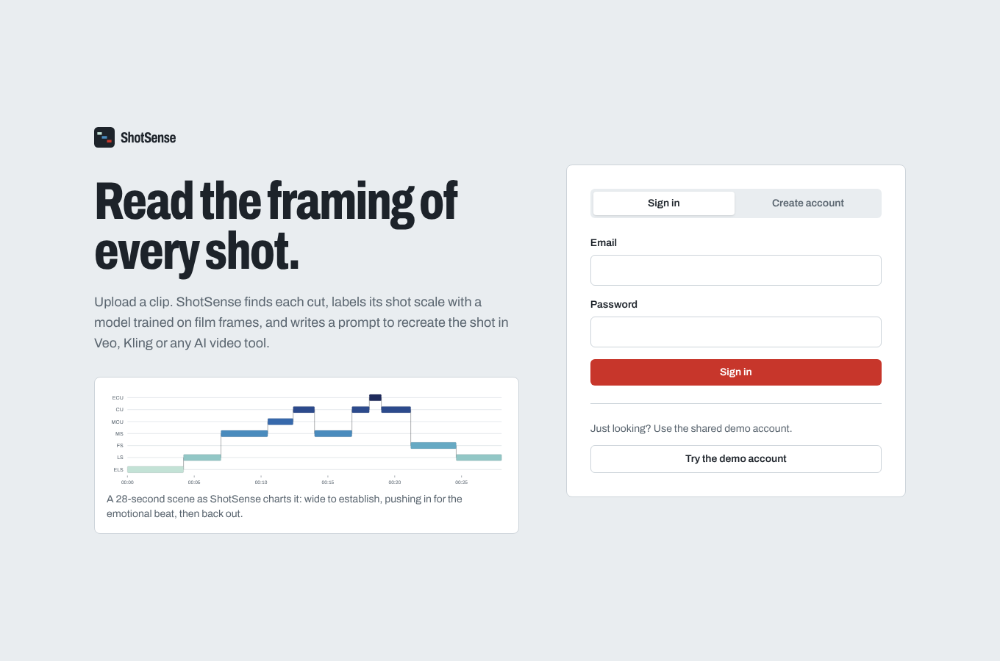
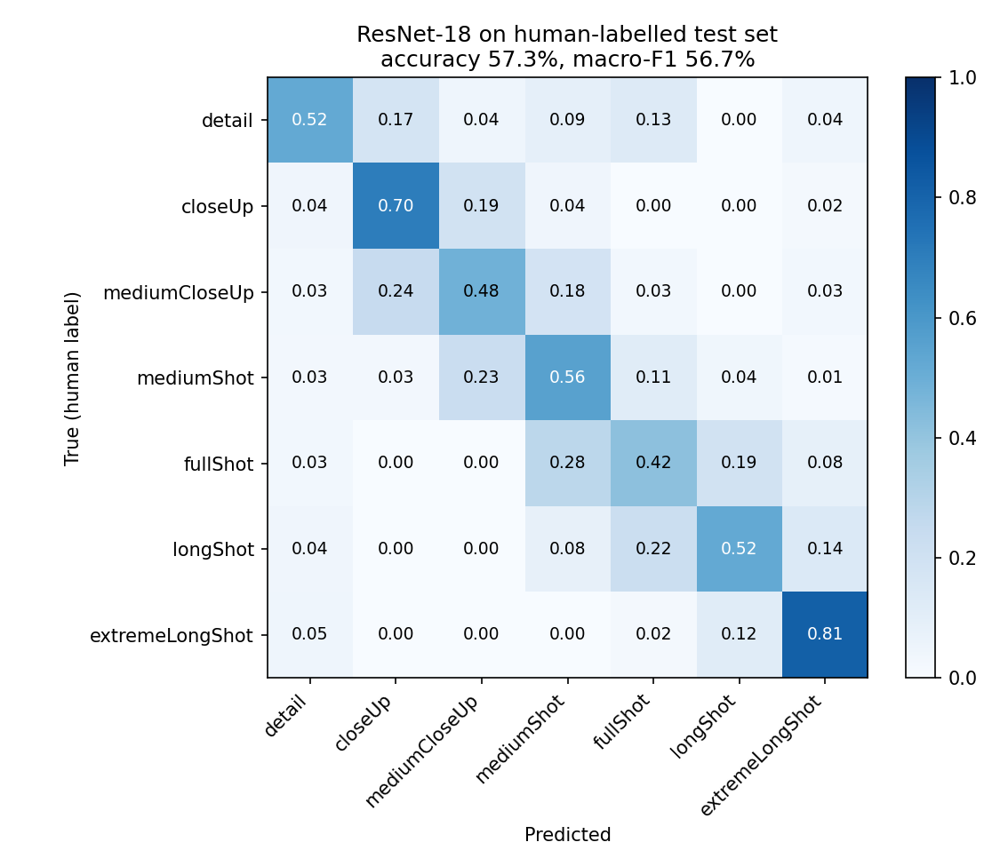
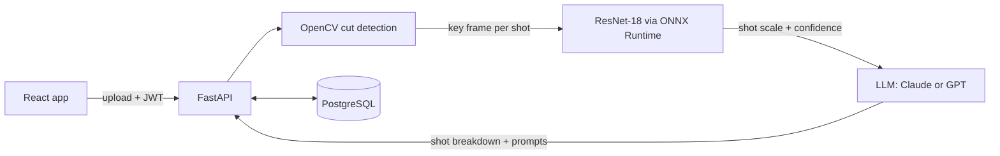

# ShotSense

**AI shot analyzer for filmmakers.** Upload a clip, and ShotSense finds every cut, labels each shot's
framing (extreme close-up to extreme long shot) with a fine-tuned ResNet-18, charts how the framing moves over time,
and uses an LLM to write a text-to-video prompt that recreates each shot in tools like Veo, Kling or Seedance.

**Live demo:** [shotsense.onrender.com](https://shotsense.onrender.com) (free hosting: the first load after a quiet spell takes about a minute while the server wakes up; use **Try the demo** for a one-time trial without signing up)



## Results

The classifier is evaluated on a held-out test set of **human-labelled** film frames that are never used in training.

| Model | Test accuracy | Test macro-F1 |
| --- | --- | --- |
| HOG features + logistic regression (scikit-learn baseline) | 32.9% | 30.6% |
| **ResNet-18, fine-tuned (PyTorch)** | **57.3%** | **56.7%** |

Random guessing across the seven classes would score about 14%. Trained on 343 human-labelled frames, validated on 172 and tested on 344 (the current dataset's AI-labelled rows ship without their images). Most errors are between neighbouring scales, such as close-up vs. medium close-up, which human labellers also disagree on.



## How it works



1. **Cut detection (OpenCV).** Frames are sampled at 5 fps. Each pair of samples is compared with an HSV colour-histogram
   distance, which catches cuts between scenes, and a grey-level pixel difference, which catches cuts within one scene
   (wide shot to close-up). A cut is declared only when the score is well above the recent baseline, so camera moves
   don't trigger it. Fades to black are dropped. The middle frame of each shot becomes its key frame.
2. **Shot-scale classification (PyTorch → ONNX).** An ImageNet-pretrained ResNet-18 is fine-tuned on labelled
   film frames. Frames are **letterboxed, never cropped**: shot scale *is* the framing, so random crops would change the
   true label. The model is exported to ONNX and served with ONNX Runtime on CPU, so the production image needs no PyTorch.
3. **Shot breakdown (LLM).** Claude or GPT receives the shot list, timecodes, predicted scales and key frames, and returns
   structured JSON: a style summary, a pacing note, and a description and video-generation prompt for each shot. With no
   API key, or if the call fails, a deterministic template keeps the app working.

### Training details

All of this lives in [`training/train_shotsense.ipynb`](training/train_shotsense.ipynb), which runs on a free Colab GPU in about 20 minutes.

- **Data:** [*What a Shot!*](https://huggingface.co/datasets/szymonrucinski/types-of-film-shots) (CC-BY-4.0): 863
  human-labelled frames plus frames labelled by a DINOv2 model with Claude Opus review. Rows whose image file isn't
  included in the download are skipped, and frames still marked ambiguous are dropped, leaving seven classes.
- **Split:** human frames 40/20/40 into train/validation/test, stratified; all AI-labelled frames go to training.
  The test set is used once, at the end.
- **Baseline:** HOG features + a small grey thumbnail, standardised, logistic regression with `C` tuned on validation.
- **ResNet-18:** class-weighted cross-entropy with label smoothing (class imbalance and noisier AI labels), lower learning
  rate for the backbone than for the head, cosine schedule with warm-up, mixed precision, GPU augmentations that keep
  framing intact (flips, colour jitter, occasional greyscale), best epoch chosen by validation macro-F1.

## Tech stack

| Layer | Tools |
| --- | --- |
| ML | PyTorch, torchvision, scikit-learn, scikit-image, pandas, NumPy, ONNX, ONNX Runtime |
| Video | OpenCV |
| Backend | FastAPI, SQLAlchemy, PostgreSQL (SQLite locally), JWT auth with bcrypt, Pydantic |
| LLM | Anthropic Messages API or OpenAI Chat Completions, with vision |
| Frontend | React, Vite, Tailwind CSS, React Router |
| Ops | Docker, GitHub Actions CI, Hugging Face Spaces or Render, Neon Postgres |

## Run it locally

Requirements: Python 3.12+, Node 20+.

```bash
# Backend: http://localhost:8000 (interactive API docs at /docs)
cd backend
python -m venv .venv && source .venv/bin/activate   # Windows: .venv\Scripts\activate
pip install -r requirements-dev.txt
cp .env.example .env                                 # optional: add an LLM key
uvicorn app.main:app --reload

# Frontend: http://localhost:5173 (calls the backend through Vite's proxy)
cd frontend
npm install
npm run dev
```

The repository ships a placeholder model, so the app runs immediately; its labels are random and the UI says so.
To get real predictions, run the training notebook and copy `shotsense.onnx` and `metrics.json` into `backend/model/`.

Tests: `cd backend && pytest`. They build a synthetic video with known cuts and check the detected boundaries,
plus auth, ownership, upload validation and the LLM fallback.

## Deploy

The root `Dockerfile` builds the React app and serves it from FastAPI, so one container hosts everything.

**Database (Neon, free):** create a project at neon.tech and copy its connection string.

**Option A: Hugging Face Spaces (free, 16 GB RAM)**
1. Create a new Space, choose **Docker** as the SDK and **Blank** as the template.
2. Push this repository to the Space, then edit `README.md` in the Space and put this header at the very top:
   ```yaml
   ---
   title: ShotSense
   sdk: docker
   app_port: 7860
   ---
   ```
3. In **Settings → Variables and secrets**, add `DATABASE_URL`, `SECRET_KEY` and optionally `ANTHROPIC_API_KEY` or
   `OPENAI_API_KEY`.

**Option B: Render:** new **Web Service** from your GitHub repo, runtime **Docker**, same environment variables.

## API

| Method | Path | Purpose |
| --- | --- | --- |
| POST | `/api/auth/register` | Create an account, returns a JWT |
| POST | `/api/auth/login` | Sign in, returns a JWT |
| POST | `/api/auth/guest` | Start a one-time demo: private guest account, limited analyses, expires after 24 hours |
| GET | `/api/auth/me` | Current user |
| POST | `/api/analyses` | Upload a video or image (multipart: `file`, `title`, `notes`) |
| GET | `/api/analyses` | Your analyses, newest first |
| GET | `/api/analyses/{id}` | One analysis with every shot |
| DELETE | `/api/analyses/{id}` | Delete an analysis |
| GET | `/api/model` | Loaded model version, classes and test metrics |
| GET | `/api/health` | Health check |

## Limitations and next steps

- The one-time demo is limited per browser (cookie) and per internet connection (a keyed hash of the IP address,
  never the raw IP). That stops casual reuse, but someone switching networks or devices can start another demo.

- The usable dataset is small (a few thousand frames with images), and the human-labelled frames carry no film ID, so frames from one film
  could appear in both train and test. A film-level split would give a stricter estimate.
- Cut detection targets hard cuts. Long dissolves and whip pans can be missed or split.
- Next: camera-movement classification (static, pan, push-in), processing long videos in a background queue, and
  exporting the shot list as an EDL for editing software.

## Credits

Training data: [*What a Shot!*](https://huggingface.co/datasets/szymonrucinski/types-of-film-shots) by szymonrucinski on Hugging Face, CC-BY-4.0. Built by Pendekatla Surya.
